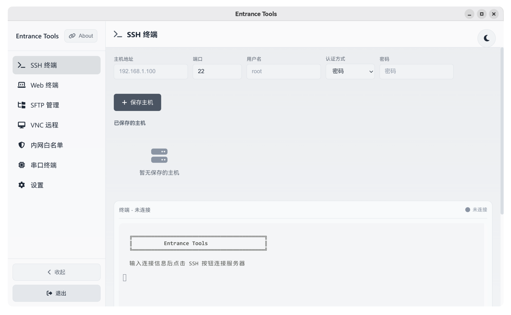

# Entrance-Desktop

[中文文档 / Chinese README](README_CN.md)

Desktop wrapper for [Entrance](https://github.com/fcanlnony/Entrance) for Linux, Windows and macOS.



## Repository Layout

- `Entrance/`: backend submodule (kept with original folder name)
- `Platform/Linux/`: C++17, GTK4, libadwaita and WebKitGTK
- `Platform/Windows/`: C++17, Win32 and WebView2 with a Mica title bar on Windows 11 22H2 or later
- `Platform/macOS/`: Electron desktop app
- `Share/Linux/`: Linux desktop icon and `.desktop` files
- `Share/Windows/`: Windows icon and shortcut assets

## Quick Start

Linux requires Node.js, CMake, a C++17 compiler, pkg-config and the development packages for GTK4, libadwaita and WebKitGTK 6.0. On Windows install Visual Studio 2022 with Desktop development with C++, CMake, the Windows SDK, and the Evergreen WebView2 Runtime. The first Windows build downloads the WebView2 SDK from NuGet.

1. Install dependencies:

```bash
npm run install:all
```

2. Start desktop app:

```bash
npm start
```

## Build Packages

On Linux, run `npm run dist:linux` or `npm run dist` to generate `Desktop/dist/Entrance-Desktop-<version>-<arch>.AppImage`. Packaging requires `patchelf` and `appimagetool` on PATH. For offline builds, install `squashfs-tools` and set `APPIMAGE_RUNTIME` to a local Type 2 runtime for the target architecture. The packager can also reuse a matching runtime from the electron-builder 12.0.1 AppImage tools cache.

Make the AppImage executable and run it directly. It includes the native client, backend and Node.js. The host provides FUSE, GTK4, libadwaita and WebKitGTK 6.0. Build on the oldest Linux distribution you intend to support so that the system library versions are compatible.

To build the Windows x64 installer on Linux, install CMake, NSIS 3 (`makensis`) and the MinGW-w64 x86_64 C++ and resource compilers (`x86_64-w64-mingw32-g++` and `x86_64-w64-mingw32-windres`). Run `npm run dist:win`. The first build downloads the pinned WebView2 SDK, Windows Node.js and locked backend packages. The result is `Desktop/dist/Entrance-Desktop-Setup-<version>-Windows-x64.exe`. Run Setup once on Windows with the Evergreen WebView2 Runtime installed. Then launch Entrance Desktop from the Start menu. Setup defaults to `%LOCALAPPDATA%\Programs\Entrance Desktop`. You can browse to another writable folder. Upgrades default to the previous installation folder. Windows Settings lists the uninstaller.

On Windows, install NSIS 3 and run `npm run dist` to create the installer in `Desktop/dist/`. On macOS the same command builds `Desktop/dist/Entrance Desktop.app`.

The native app starts the bundled Entrance backend on loopback and closes it when the window exits. Set `PORT` to choose its port (default 3000). To open an already running web frontend, set `ENTRANCE_AUTOSTART=0` and `ENTRANCE_URL`.

感谢测试: [makabaka2240](https://github.com/makabaka2240) 
