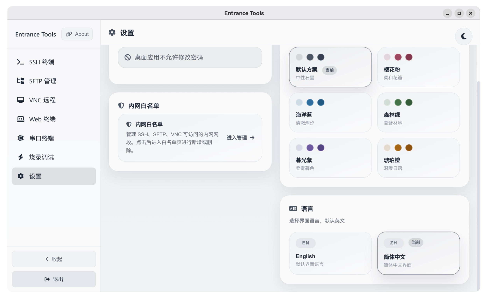

# Entrance-Desktop

[English README](README.md)

适用于 Linux、Windows 和 macOS 的 [Entrance](https://github.com/fcanlnony/Entrance) 桌面封装。



## 仓库结构

- `Entrance/`: 后端子模块，保持原始目录名不变
- `Platform/Linux/`：C++17、GTK4、libadwaita 和 WebKitGTK
- `Platform/Windows/`：C++17、Win32 和 WebView2；Windows 11 22H2 及以上支持 Mica 标题栏
- `Platform/macOS/`：Electron 桌面封装
- `Share/Linux/`: Linux 桌面图标与 `.desktop` 文件
- `Share/Windows/`: Windows 图标与快捷方式资源

## 快速开始

Linux 构建需要 Node.js、CMake、C++17 编译器、pkg-config，以及 GTK4、libadwaita 和 WebKitGTK 6.0 开发包。Windows 构建需要 Visual Studio 2022 的 C++ 桌面开发工作负载、Windows SDK 和 CMake，运行需要 Evergreen WebView2 Runtime。首次 Windows 构建会从 NuGet 下载 WebView2 SDK。

1. 安装依赖：

```bash
npm run install:all
```

2. 启动桌面应用：

```bash
npm start
```

原生客户端启动本地 Entrance 后端，关闭窗口时结束后端进程。`PORT` 可指定监听端口（默认 3000）。要连接已有 Web 服务，可设置 `ENTRANCE_AUTOSTART=0` 和 `ENTRANCE_URL`。

## 构建安装包

在 Linux 上运行 `npm run dist:linux` 或 `npm run dist`，生成 `Desktop/dist/Entrance-Desktop-<版本>-<架构>.AppImage`。打包需要 `patchelf` 和 PATH 中的 `appimagetool`。离线构建也可以安装 `squashfs-tools`，通过 `APPIMAGE_RUNTIME` 指定目标架构的 Type 2 runtime，或复用 electron-builder 的 AppImage 12.0.1 工具缓存。

给 AppImage 添加执行权限后即可直接运行。包内包含原生客户端、Entrance 后端和 Node.js，系统需提供 FUSE、GTK4、libadwaita 和 WebKitGTK 6.0。要兼容较旧的发行版，请在计划支持的最旧系统上构建，以匹配系统库版本。

在 Linux 上交叉构建 Windows x64 版本，需要 CMake、NSIS 3（`makensis`）和 MinGW-w64 的 `x86_64-w64-mingw32-g++`、`x86_64-w64-mingw32-windres`。运行 `npm run dist:win`，首次构建会下载固定版本的 WebView2 SDK、Windows 版 Node.js 和锁定的后端依赖。产物为 `Desktop/dist/Entrance-Desktop-Setup-<版本>-Windows-x64.exe`。在装有 Evergreen WebView2 Runtime 的 Windows 上运行一次安装程序，此后从开始菜单打开 Entrance Desktop。安装向导默认选择 `%LOCALAPPDATA%\Programs\Entrance Desktop`，可以浏览选择其他可写目录；升级时默认使用上次的安装位置。安装后可在 Windows 设置的“已安装的应用”中卸载。

在 Windows 上安装 NSIS 3 后运行 `npm run dist`，可在 `Desktop/dist/` 生成同样的安装程序。在 macOS 上运行同一命令会生成 `Desktop/dist/Entrance Desktop.app`。

感谢测试: [makabaka2240](https://github.com/makabaka2240)
